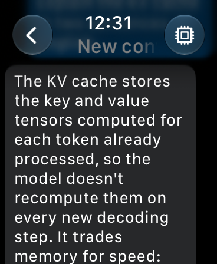
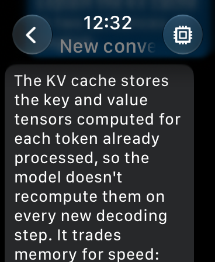

# Hermes Watch

An Apple Watch app for [Hermes Agent](https://github.com/NousResearch/hermes-agent): read your conversations, start a
new one, dictate or type a message, watch the reply stream in, stop a turn, and pick the model, all from the wrist.

Unofficial community project. Not affiliated with Nous Research.

<p>
  
  
</p>

## Why there is a bridge

The Hermes dashboard takes prompts over a WebSocket (`/api/ws`). An ordinary watch app is not allowed to open one:
[Apple TN3135](https://developer.apple.com/documentation/technotes/tn3135-low-level-networking-on-watchos) counts
`URLSessionWebSocketTask` as low-level networking, which watchOS only permits to audio streaming and VoIP apps while
they stream or run a call. The same note warns that the simulator always allows it, so the problem only shows on a
real watch. Plain HTTP and HTTPS through `URLSession` are open to every app.

Measured with this app: in the simulator the dashboard WebSocket opens in 0.1 s; on a real Series 11 the same build
fails after 0.2 s with `NSURLErrorDomain -1009`, while its HTTPS calls go through.

So the watch speaks plain HTTP to a small bridge that keeps one WebSocket to the dashboard:

```
Apple Watch  --HTTPS-->  watch_bridge.py  --WebSocket-->  Hermes dashboard
             POST /rpc                      JSON-RPC 2.0
             GET  /events (long poll)
```

The bridge is one Python file (`bridge/watch_bridge.py`, about 200 lines, FastAPI). It:

- forwards only the calls the app needs (list, create, resume, history, submit, interrupt, model options, model
  switch for one conversation); anything else is refused, so nothing can be deleted or reconfigured from the wrist;
- asks for the same bearer token as the dashboard;
- listens on loopback only; you put your own HTTPS address in front of it;
- changes nothing in Hermes.

[docs/PROPOSAL.md](docs/PROPOSAL.md) describes how these two endpoints could live in the dashboard itself, which would
make the bridge unnecessary.

## What you need

- Hermes Agent with its dashboard running, reachable from your phone (the address your phone app already uses).
- A Mac with a recent Xcode (built and tested with Xcode 27.2) and [XcodeGen](https://github.com/yonaskolb/XcodeGen) (`brew install xcodegen`).
- An Apple Watch with Developer Mode on (tested on a Series 11 with watchOS 27; the deployment target is watchOS 10). A free Apple account is enough (the app then has to
  be reinstalled every 7 days).

## Set up

**1. Start the bridge** on the machine that runs Hermes:

```sh
pip install -r bridge/requirements.txt
python bridge/watch_bridge.py --upstream wss://YOUR-HOST:PORT/api/ws --token YOUR-DASHBOARD-TOKEN
```

**2. Give the bridge an HTTPS address your phone can reach.** The watch talks through the paired iPhone, so any address
the iPhone reaches works: a private network with HTTPS, or a reverse proxy. Plain `http://` is only accepted for local
addresses. Keep the bridge off the public internet.

**3. Build and install the app.**

```sh
cp App/Local.xcconfig.example App/Local.xcconfig     # your team id, your bundle id, optionally the bridge address
scripts/install_on_watch.sh "Name of your watch"
```

The address and the token can also be typed on the watch: open the app, tap the gear, fill in *Address* and *Token*,
then *Test connection*. Nothing has to be rebuilt to change them.

First time with a watch: pair it from Xcode (Devices), with Wi-Fi on for the Mac, and keep the watch awake and
unlocked while the script runs. The connection drops each time the watch sleeps; the script retries.

## Try it without a watch

```sh
HERMES_TOKEN=YOUR-DASHBOARD-TOKEN scripts/sim_demo.sh
```

builds for the simulator, runs one real turn through a bridge on `127.0.0.1:9120`, and saves screenshots.

## Tests

```sh
cd HermesCore && swift test                                   # state reducer, no network
HERMES_TOKEN=... python bridge/test_bridge.py                 # end to end against a running bridge and a real model turn
```

The bridge test checks that a missing token and forbidden methods are refused, then lists, creates, switches the
model for one conversation, submits, follows events to the end of the reply, and interrupts a running turn.

## Layout

| Path | What |
|---|---|
| `App/` | SwiftUI watch app (XcodeGen project). English, with French. |
| `HermesCore/` | Swift package: JSON, models, the chat state reducer, the bridge client. |
| `bridge/` | The HTTP bridge and its end-to-end test. |
| `scripts/` | Install on a real watch; simulator demo. |

## Limits

- Text only: no images, no voice replies, no attachments.
- No notification when a reply finishes while the app is closed.
- Tool approvals are not handled: answer them from another client.
- A model that asks for a confirmation has to be picked from the desktop or phone app.

## Licence

MIT. "Hermes" and "Hermes Agent" belong to Nous Research.
